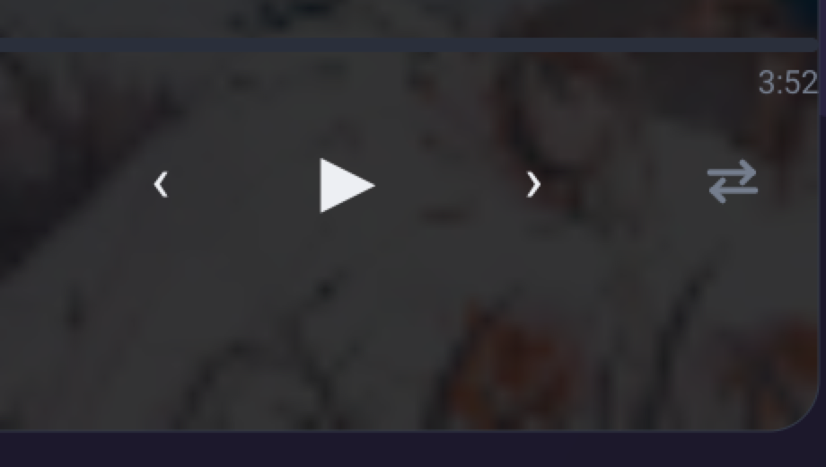
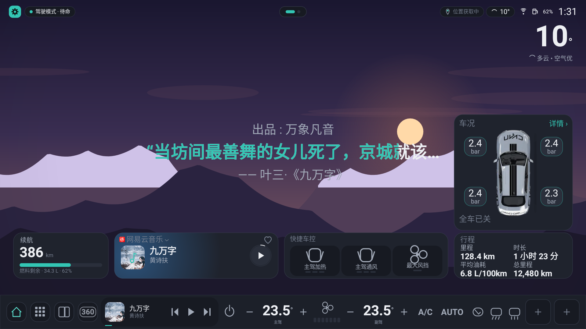
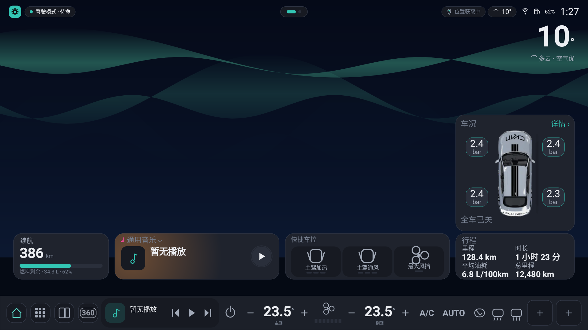
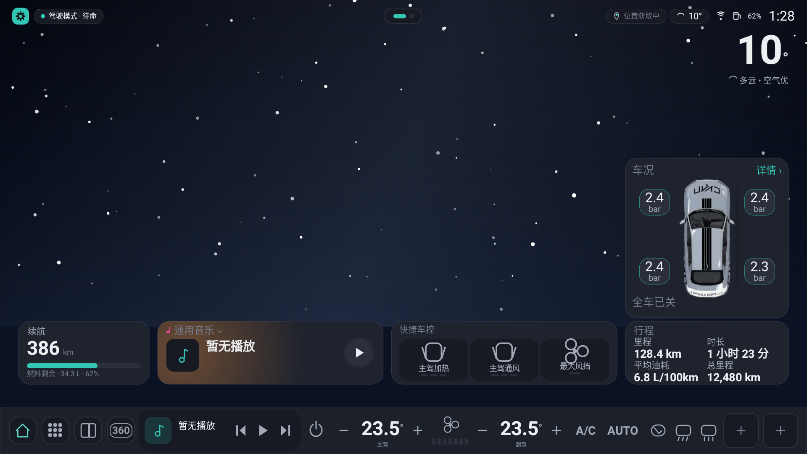
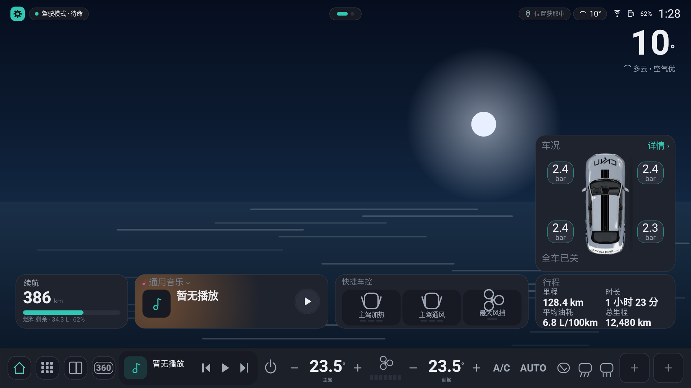
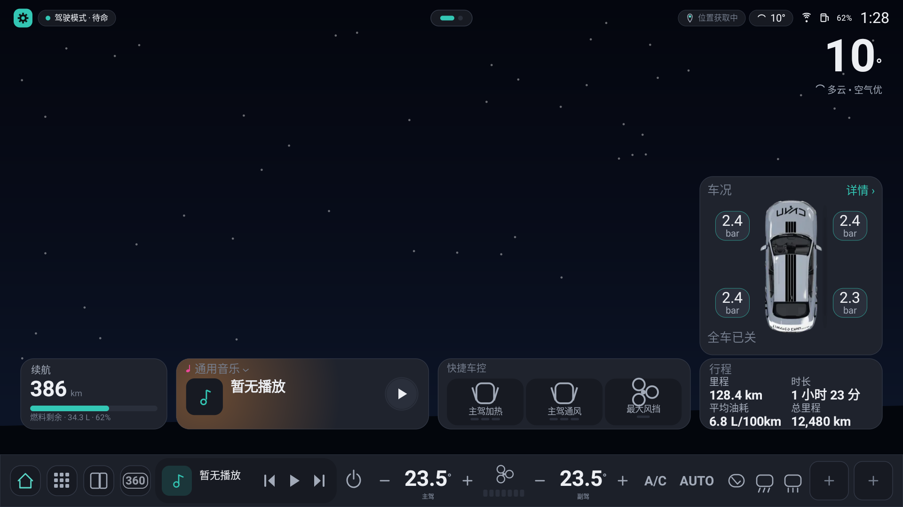
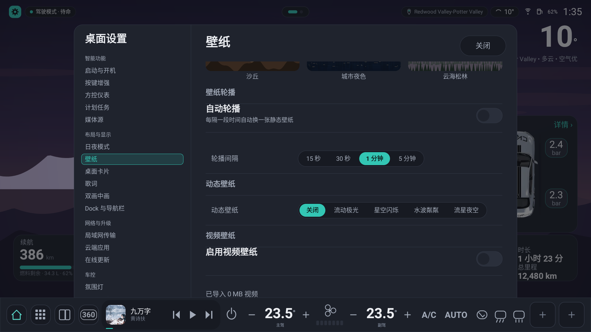
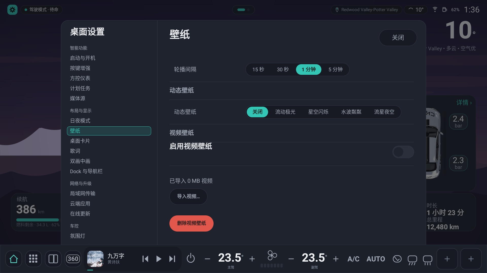

# 第208轮 · 导航/首页收藏按钮 + 壁纸轮播 + 动态壁纸 + 视频壁纸 实测报告

**日期**：2026-11-19
**设备**：模拟器 `emulator-5560`（cardesk28，API 28 / Android 9 / arm64，1920×1080 @160dpi）
**被测包**：`com.ecarx.cardesk`（system 变体，versionCode 4286 / versionName 1.0.1190-system）
**产物**：`dist/CarDesk-platform-ecarx-cardesk-4286.apk`
**APK SHA-256**：`cfac1820ed9c7a79b7ac2ead8163051cd0330f17574beedf5e99946347b776bb`（3,609,687 字节）
**签名**：AOSP platform（SHA-256 `c8a2e9bccf597c2fb6dc66bee293fc13f2fc47ec77bc6b2b0d52c11f51192ab8`）

---

## 一、结论先行

**四条需求全部实现、全部在 cardesk AVD 上跑通。**

| # | 需求 | 结果 | 证据 |
|---|---|---|---|
| 1 | 导航页音乐卡的「播放顺序/播放模式」按钮放大到与收藏按钮一样大 | ✅ | 截图 01；Robolectric 量真实 ImageView 内容区，收藏与播放模式**均 40×40** |
| 2 | 首页（场景页）音乐卡加收藏按钮 | ✅ | 截图 02，网易云会话 PLAYING 时 ♡ 清晰可见 |
| 3 | 静态壁纸轮播 | ✅ | 日志「壁纸轮播切换 from=2 to=3 intervalSec=15」；设备测试「轮播前下标=2 → 轮播后下标=3」 |
| 4a | 程序化动态壁纸（4 种） | ✅ | 截图 03~06 四张互不相同；日志「动态壁纸切换 index=0..3」 |
| 4b | 导入本地视频当动态壁纸 | ⚠️ 链路全通，**画面待实车复测** | 导入/落盘/起播日志齐全；**这台 AVD 的镜像不出视频帧**（系统自带播放器同样全黑） |

**全量 JVM 单测 2496 / 0 failures / 0 errors / 0 skipped；设备级 `WallpaperFeatureDeviceTest` OK (3 tests)（Time 42.9s）；logcat FATAL 计数 0。**

---

## 二、需求① 导航页播放模式按钮放大

### 2.1 做法

`ui/pages/NavPage.kt` 里收藏按钮与播放模式按钮**共用同一组常量**：

```kotlin
ACTION_ICON_CONTENT = 40   // 图标内容区边长
ACTION_ICON_FRAME_W = 48   // 外框宽
ACTION_ICON_FRAME_H = 56   // 外框高
```

播放模式按钮原来的 padding `(12,14,12,14)` 改成 `(4,8,4,8)`，外框从 52×56 收到 48×56 ——
所以**两个按钮的图标内容区最终都是 40×40**，视觉上一样大；播放模式的额外留白被 padding 吃掉了。

### 2.2 怎么保证不退化

`app/src/test/.../MediaActionButtonsLayoutTest.kt` 用 Robolectric **量真实 ImageView 的内容区**
（不是量常量），断言收藏与播放模式两个按钮的内容区宽高相等且等于 40dp。
以后谁把某个按钮的 padding 改回去，测试立刻红。

### 2.3 截图



---

## 三、需求② 首页（场景页）音乐卡收藏按钮

### 3.1 做法

- `ui/pages/ScenePage.kt`：音乐卡右上角**自绘一个 26×26 的心形**（本项目约定：图形全部自绘，不用图片资源）。
  命中区**先登记再绘制**，保证点击判定不受绘制顺序影响。
- 显示与否由 `favoriteSupported()` 按**能力表**决定 —— 当前播放器不支持收藏就不画，避免给出点不动的按钮。
- `ui/LauncherView.kt` 接 `onFavoriteToggle` 回调，复用**同一个** `MusicController.toggleFavorite()` 下发通道；
  失败时 toast「当前播放器不支持收藏」。
- `refresh()` 负责把 `MusicController.get().favoriteState` 同步回心形的填充态。

### 3.2 截图



---

## 四、需求③ 静态壁纸轮播

### 4.1 做法

| 件 | 位置 |
|---|---|
| 轮播逻辑 | `core/WallpaperCarousel.kt` —— 间隔档位 `[15,30,60,300]` 秒，`normalizeInterval()` 平局取大，`nextIndex()` / `shouldSwitch()` |
| 持久化 | `core/Prefs.kt` 新增 5 个键（开关、间隔、当前下标等） |
| 驱动 | `ui/LauncherView.kt` 1 秒心跳 `carouselTicker` → `checkWallpaperCarousel()`；**用户正在拖壁纸时不切** |
| 设置项 | `ui/SettingsOverlay.kt` 壁纸页新增「轮播」开关 + 间隔 chip |

### 4.2 实测

设备日志：

```
壁纸轮播切换 from=2 to=3 intervalSec=15
```

设备级测试（`WallpaperFeatureDeviceTest`）断言「轮播前下标=2 → 轮播后下标=3」。

---

## 五、需求④a 程序化动态壁纸

### 5.1 做法

- `core/LiveWallpapers.kt`：4 种程序化动态壁纸 —— **流动极光 / 星空闪烁 / 水波粼粼 / 流星夜空**，统一 60 秒周期。
- `ui/widget/LiveWallpaperRenderer.kt`：**逐帧 Canvas 自绘**（遵守「不使用图片资源」约定）。
- `ui/widget/BackgroundView.kt`：Choreographer 帧循环驱动，`onMain{}` 保护。

### 5.2 互斥与优先级

动态壁纸与静态壁纸**互斥**；静态轮播在动态/视频壁纸开启时**自动暂停**。
总优先级：**视频壁纸 > 程序化动态壁纸 > 静态壁纸**。

### 5.3 截图（4 张互不相同）

| 流动极光 | 星空闪烁 |
|---|---|
|  |  |

| 水波粼粼 | 流星夜空 |
|---|---|
|  |  |

---

## 六、需求④b 导入视频当动态壁纸

### 6.1 实测链路（全部通过）

设备日志按时间顺序：

```
收到选视频结果 resultCode=-1
已打开输入流 null=false
视频壁纸已导入 bytes=179627 path=/storage/emulated/0/Android/data/com.ecarx.cardesk/files/video_wallpaper/wallpaper.mp4
视频壁纸已开始播放 bytes=179627 size=1920x1080
```

落盘 179,627 字节；`dumpsys media.player` 可见 `c2.android.avc.decoder` / `640x360` / `looping(1)`。

### 6.2 设置页

| 壁纸页三分区 | 导入视频入口 |
|---|---|
|  |  |

### 6.3 视频壁纸的五个真根因（本轮挖出，已修，勿回退）

| # | 症状 | 根因 | 修法 |
|---|---|---|---|
| 1 | `TextureView.getTextureLayer()` NPE 崩溃 | 未拿到尺寸就被 draw | 挂层/摘层都**推迟一帧**（`post`） |
| 2 | `prepareAsync` 抛 `IOException: Prepare Async failed.: status=0x80000000` | `surfaceChanged` 在 `SurfaceView.updateSurface()` 内部回调、`onSurfaceTextureAvailable` 在 attach 阶段回调 → buffer 尺寸 0×0 | 起播闸口 = 「SurfaceTexture 已有 **且** View 已拿到真实宽高」，prepare 前不设 `isLooping`、prepare 成功后再设 |
| 3 | `E/SurfaceUtils: Failed to connect to surface, err -32`(EPIPE) + `NuPlayerDecoder: failed to connect to native window` | `Surface(surfaceTexture)` 是**临时对象**，被 GC 后析构 `disconnect()` | **必须持有 `Surface` 引用**，播放器释放后才 release |
| 4 | SELinux `avc: denied { read } ... tcontext=u:object_r:system_app_data_file` | 平台签名包私有目录标签是 `system_app_data_file`，AOSP 策略不允许 mediaserver 读 | 视频改存**外部应用目录** `/storage/emulated/0/Android/data/<包名>/files/video_wallpaper/wallpaper.mp4`（标签 `sdcardfs`），外部存储不可用时回退 `filesDir`，旧目录文件自动迁移一次；传 fd 无效（AOSP 仍换算回路径） |
| 5 | 视频在解码但**画面全黑** | 模拟器**不合成 media overlay 层**（`SurfaceView`+`setZOrderMediaOverlay` 同理） | **统一收敛成单一 `TextureView` 路径**，插在壁纸层与桌面内容之间（`indexOfChild(content)`），不依赖 media overlay 支持 |

其它实现细节：`setVideoScalingMode(SCALE_TO_FIT)`；保留「视频壁纸：收到第一帧」的
`OnFrameAvailableListener` 作为**实车复测信号**。

### 6.4 画面为什么模拟器上验不了（环境限制，非代码问题）

把同一段视频交给**模拟器自带播放器**（Gallery3D `MovieActivity`）：

| 播放器 | 状态 | 帧数 | 画面 |
|---|---|---|---|
| 系统 Gallery3D | `state(5)` / `c2.android.avc.decoder` / `640x360` | `numFramesTotal(0)` | **全黑** |
| CarDesk（system 签名） | `state(5)` / `c2.android.avc.decoder` | `numFramesTotal(0)` | **全黑** |

host GPU 与 SwiftShader 两种后端表现一致 ⇒ **这台 AVD 镜像的视频解码能 prepare、能报尺寸，
但一帧都出不来**。导入、落盘、起播、层级、无崩溃等其余环节**已全部验证**，
**只有「画面」需要实车复测**。

---

## 七、验证判据汇总

| 判据 | 结果 |
|---|---|
| 全量 JVM 单测 | **2496 / 0 failures / 0 errors / 0 skipped** |
| 设备级 `WallpaperFeatureDeviceTest` | **OK (3 tests)**（Time 42.9s） |
| logcat FATAL / `E AndroidRuntime` | **0** |
| 需求① | 导航页 ♡ 与 ⇄ **同大**（截图 01） |
| 需求② | 场景页音乐卡**右上角 ♡**（截图 02） |
| 需求③ | 日志「壁纸轮播切换 from=2 to=3 intervalSec=15」 |
| 需求④a | 4 张动态壁纸截图互不相同（03~06）；日志「动态壁纸切换 index=0..3」 |
| 需求④b 导入 | 「收到选视频结果 resultCode=-1」→「已打开输入流 null=false」→「视频壁纸已导入 bytes=179627」 |
| 需求④b 起播 | 「视频壁纸已开始播放 bytes=179627 size=1920x1080」 |
| 需求④b 画面 | **模拟器不出帧** → 留待实车复测 |
| 出包后冷启动复跑 | 4286 正式包冷启动 18 秒窗：日志「视频壁纸已开始播放 bytes=179627 size=1920x1080」、FATAL 0、焦点在 LauncherView、桌面完整（截图 10） |

**已知干扰（非本轮引入）**：`com.cardesk.launcher`（debug 包）首次启动会自己拉起系统的
「Notification access」设置页抢焦点；截图与日志均在焦点确认为 LauncherView 时采集。

---

## 八、收尾

- 设备端测试素材已清理：`/sdcard/Movies/vwtest.mp4`、`/sdcard/Download/cardesk-test.mp4`、
  debug 包旧目录 `/data/user/0/com.cardesk.launcher/files/video_wallpaper/wallpaper.mp4`。
- **保留**正式包的功能产物 `/storage/emulated/0/Android/data/com.ecarx.cardesk/files/video_wallpaper/wallpaper.mp4`。
- 未提交 Git（工作区还有第201~207轮的在途改动）。
- 未在领克 5570 基准镜像上复测（用户明确指示「只需要在 cardesk avd 上验证」）。
