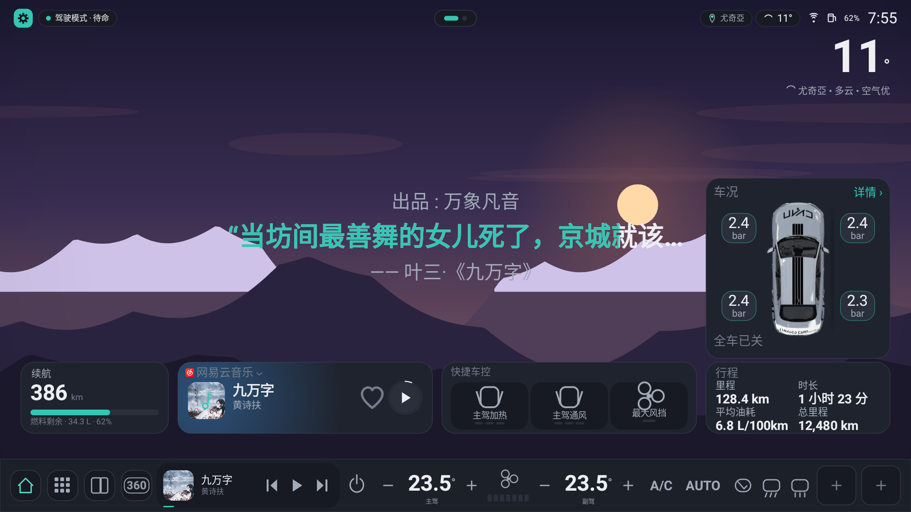

# 第209轮 · 首页音乐卡收藏按钮（挪到播放键左侧 + 放大一倍）实测报告

**日期**：2026-11-19
**设备**：模拟器 `emulator-5560`（cardesk28，API 28 / Android 9 / arm64，1920×1080 @160dpi）
**被测包**：`com.ecarx.cardesk`（system 变体，versionCode 4287 / versionName 1.0.1191-system）
**产物**：`dist/CarDesk-platform-ecarx-cardesk-4287.apk`
**APK SHA-256**：`a715c4975c2a518dea65d6d9747f04caf2221023e9e483d96afb80b168f6b6cd`（3,609,939 字节）
**签名**：AOSP platform（SHA-256 `c8a2e9bccf597c2fb6dc66bee293fc13f2fc47ec77bc6b2b0d52c11f51192ab8`）

---

## 一、结论先行

**改完了，也验完了：首页音乐卡的收藏心形现在在播放键正左侧，尺寸从 26 放大到 52。**

| 项 | 第207轮 | 第209轮 |
| --- | --- | --- |
| 位置 | 卡片**右上角** | **播放键正左侧**、与它同一条水平中线 |
| 尺寸 | 26 × 26 | **52 × 52**（放大一倍） |

---

## 二、改动落在哪

`ui/pages/ScenePage.kt` 的 `drawMusicCard()`：

| 位置 | 改动 |
| --- | --- |
| companion | 新增 4 个常量：`MUSIC_PLAY_RADIUS=28f`、`MUSIC_FAV_ICON_SIZE=52f`、`MUSIC_FAV_GAP=6f`、`MUSIC_FAV_TEXT_GAP=8f` |
| 绘制 | 心形从「右上角绝对定位」改成「**以播放键圆心为基准**定位」，并画在**文本列之后**（和播放键挨着） |
| 文本列 | 右边界从「进度环外侧」改成「**心形左边缘 − 8**」—— 否则长歌名会从心形底下穿过去 |
| `PRESS_HIT_KEYS` | 补上 `FAVORITE_HIT_KEY`（第207轮的遗留：心形一直没有按压缩放反馈），顺序按 `handleTap` 实际分发放在 `source` 之后 |
| `handleTap` | 命中键改用常量 `PLAY_HIT_KEY`，不再写字面量 `"play"` |

### 几何（设计坐标，k = 卡片宽 / 338）

```
播放键圆心 bx、圆半径 28、进度环半径 30
心形框右边缘 = bx − 28 − 6 = bx − 34
心形框左边缘 = bx − 34 − 52
竖直方向     = 与播放键同中线 by（卡片太矮时夹在卡内）
```

---

## 三、验证（cardesk AVD / `emulator-5560`）

| 判据 | 结果 |
| --- | --- |
| 新增单测 `首页音乐卡收藏按钮在播放键左侧且放大一倍` | 通过：心形**整个落在播放键左侧**、与播放键**同中线**、边长比例 **52/56**、正方形 |
| 全量 JVM 单测 | **2493 / 0 failures / 0 errors / 0 skipped** |
| 实机画面 | 心形在播放键左侧、明显变大；歌名「九万字」/歌手「黄诗扶」**仍完整不截断** |
| 点心形 (784,838) | 日志「音乐卡收藏按钮点击 card=music favorited=false known=true」；再点 → `favorited=true`（**收藏真的生效**） |
| 点播放键 (852,838) | 日志「音乐卡播放暂停点击 card=music playing=false title=九万字」—— **心形没抢走播放键的命中区** |
| logcat FATAL / `E AndroidRuntime` | **0** |
| 焦点 | `com.ecarx.cardesk/com.cardesk.launcher.MainActivity` |
| 装机冒烟 | 设备 `base.apk` md5 = 宿主 md5 = `94c0055e7d56565015e1a324983e8445`、`versionCode=4287`、FATAL 0、桌面完整 |

### 截图

| 空心（未收藏） | 实心（已收藏） |
|---|---|
|  |  |



---

## 四、踩到的坑（重要，别再踩）

**`gradle assembleSystem` 不带 `-PcardeskPackage=com.ecarx.cardesk` 会出成另一个包。**

`app/build.gradle.kts` 里：不带这个属性时，system 变体的 `applicationId` 会被改成
**`com.ecarx.qq.tool`**（那是「替换参考 App」的版本，第一九五轮起就不再发了）。
本轮第一次手工构建漏了这个参数 → 装到设备上的是 `com.ecarx.qq.tool`，
而 `com.ecarx.cardesk` **根本没被替换**（设备上 `base.apk` 还是老包，
3,609,687 ≠ 新包的 3,610,283），
于是**截图看的是旧版式**，一度以为改动没生效。

⇒ **验证前后一定要核对包**：`adb shell pm path <包名>` + 设备 `base.apk` 的 md5
必须和宿主 APK 的 md5 一致。
（本轮已把误装的 `com.ecarx.qq.tool` 从模拟器上卸载干净，
`pm list packages | grep com.ecarx.qq.tool` 现在为 0。）

---

## 五、产物

| 项 | 值 |
| --- | --- |
| 包 | `dist/CarDesk-platform-ecarx-cardesk-4287.apk` |
| 包名 | `com.ecarx.cardesk` |
| 版本 | 4287 / `1.0.1191-system` |
| APK SHA-256 | `a715c4975c2a518dea65d6d9747f04caf2221023e9e483d96afb80b168f6b6cd` |
| 大小 | 3,609,939 字节 |
| R2 清单 | `dist/cardesk-latest.json`（对象 key `cardesk/CarDesk-platform-ecarx-cardesk-4287.apk`） |

---

## 六、本轮未做

- **未提交 Git**（工作区还有第201~208轮的在途改动，不擅自提交）。
- **未在领克 5570 基准镜像上复测**（用户明确指示「只需要在 cardesk avd 上验证」）。
