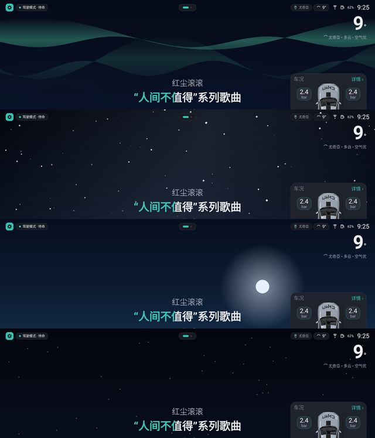

# 第212轮 · 修复第211轮挖出的两个缺陷 · 实测报告

**日期**：2026-11-19
**设备**：模拟器 `emulator-5560`（cardesk28，API 28 / Android 9 / arm64，1920×1080 @160dpi，host GPU）
**对比对象**：**4288**（修复前）vs **4289**（修复后）

---

## 一、结论先行

1. **缺陷① 壁纸轮播心跳的生命周期** —— 修好了（重建不再叠加、detach 之后会停），两个用例各配一次变异检查。
2. **缺陷② 动态壁纸每帧重建 shader / 路径 / 随机参数** —— 修好了，**画面逐像素不变**
   （星空 / 水波 / 流星 **0 差异**；极光只有 ≤2/255 的透明度舍入差）。
3. **⚠️ 修正第211轮的一个判断**：我第211轮说"每帧重建就是那 20ms 帧耗时的主因" —— **错了**。
   交替重复实测：修复前后 **p50 帧耗时都是 20ms**，app CPU 只降约 2%。
   那 20ms 的真凶是**填充率**（每帧 ≈340 万像素的带渐变填充），不是对象分配。

---

## 二、缺陷① 轮播心跳的生命周期

### 2.1 原样

| 位置 | 问题 |
|---|---|
| `LauncherView.kt:295` | `carouselTicker.run()` 每次 **new 一个 Handler**，不走类里的 `handler` 字段（`:563`） |
| `LauncherView.kt:4992` | `onDetachedFromWindow()` 只有 `handler.removeCallbacksAndMessages(null)` → **清不掉它** |
| `LauncherView.kt:1089` | `build()` 里 `postDelayed(carouselTicker, 1000)` **前面没有 removeCallbacks** |
| `LauncherView.kt:2132` / `:4115` | 换肤、改底栏形态都会重跑 `build()` → **每重建一次多挂一条链** |

### 2.2 改法

统一走类里的 `handler`：

- `run()` → `handler.postDelayed(this, 1000L)`；
- `build()` 里 post 前先 `handler.removeCallbacks(carouselTicker)` **去重**；
- `onAttachedToWindow()` 里**补挂**（detach 时心跳被一起清掉了，桌面切后台再回来轮播不能停）；
- `onDetachedFromWindow()` 里显式 `handler.removeCallbacks(carouselTicker)`。

### 2.3 用例 + 变异检查

`app/src/test/java/com/cardesk/launcher/WallpaperCarouselTickerTest.kt`（用 `carouselTickCountForTest()` 数心跳次数）：

| 用例 | 盯什么 | 变异检查 |
|---|---|---|
| `心跳稳定时每秒只跑一次` | 3 秒 ≈ 3 次 | — |
| `重建不会让心跳叠加` | 重建 3 次后 3 秒仍 ≈ 3 次（修之前 12 次） | 去掉 `removeCallbacks` → **FAILED** ✅ |
| `detach 之后心跳停` | detach 后不再跑 | 心跳改回自己 new Handler → **FAILED** ✅ |

---

## 三、缺陷② 动态壁纸每帧重建

### 3.1 原来每帧新建的东西

| 每帧新建的东西 | 次数 | 本轮改成 |
|---|---|---|
| 极光带的 `LinearGradient` | 3 | 按尺寸缓存 |
| 银河带 / 水面 / 月晕 / 流星拖尾的 shader | 1~2 | 按尺寸缓存 |
| 前景地面 `Path` | 1 | 按尺寸缓存 |
| `Random(种子)`（星点 / 波纹 / 流星的随机参数） | 1 | 按尺寸**预生成一次** |
| 波纹的 `RectF` | 26 | 复用同一个 |

### 3.2 画面不变的保证

- 随机参数**按原来的顺序、用原来的种子**抽一次再缓存（顺序一变星星就全换位置）；
- 极光带原来把透明度拆在两处（shader 的 alpha × `paint.alpha`，合成后 `0x66 × breathe²`），
  现在 shader 固定 `0x66`、把 `breathe²` 折进 `paint.alpha` —— **合成结果一致**。

### 3.3 逐像素对拍（`LiveWallpaperRendererParityTest`）

把**改造前的实现原样抄一份**放在测试里当"参考实现"，同一时刻、同一尺寸各画一张比对：

| 动态壁纸 | 差异像素 | 最大通道差 |
|---|---|---|
| 流动极光 | 1787~3891 / 57600（约 3~7%） | **≤ 2**（透明度舍入，深色渐变上不可见） |
| 星空闪烁 | **0** | **0** |
| 水波粼粼 | **0** | **0** |
| 流星夜空 | **0** | **0** |

**变异检查**：把新实现的星点 `x/y` 抽取顺序对调 → 对拍测试 **FAILED** ✅（不是空断言）。

---

## 四、⚠️ 修正第211轮的判断：帧耗时不是分配造成的

第211轮写的「每帧重建 Path / Shader → **这就是那 20ms 帧耗时的主要来源**」**是错的**。

**交替重复实测**（同一个包来回换，避免顺序效应；60 秒窗口）：

| 场景 | app CPU% | 宿主 qemu% | 整机 busy% | fps | 卡顿% | p50 帧耗时 |
|---|---|---|---|---|---|---|
| 4288 修复前 · 第1轮 | 5.19 | 78.6 | 15.76 | 53.0 | 97.2 | 20.0 |
| **修复后 · 第1轮** | **5.09** | 79.4 | 16.18 | 53.0 | 97.08 | **20.0** |
| 4288 修复前 · 第2轮 | 5.31 | 82.9 | 16.71 | 53.0 | 85.04 | 21.0 |
| **修复后 · 第2轮** | **5.25** | 80.0 | 16.03 | 53.0 | 96.86 | **20.0** |

⇒ **帧耗时前后没变**（p50 都 20ms），app CPU 只降约 2%。
⇒ 那 20ms 的真凶是**填充率**：
每帧铺满 1920×1080 的渐变夜空（**200 万像素**）+ 3 条带 alpha 的渐变极光带（**≈140 万像素**）
≈ **340 万像素/帧**的带渐变求值填充。

（另外：第211轮报告里 4288 的一次测量 p50=8ms 是**单次异常**，
这次交替重复两轮都稳定在 20~21ms —— 印证了那个数不可信。）

⇒ **本轮缓存改造的价值**：消除每帧垃圾（正确的工程习惯 + 避免长时间运行的 GC 抖动），
**不是**帧耗时优化。
⇒ 要压动态壁纸的帧耗时，得走**降帧**（30fps → CPU 砍半、帧预算变 33ms）或**降填充率**
（把静态的夜空缓存成位图、只重画动的部分）—— 那是**产品级取舍**，本轮没做。

---

## 五、验证

| 判据 | 结果 |
|---|---|
| 全量 JVM 单测 | **2501 / 0 failures / 0 errors / 0 skipped**（新增 6 个） |
| 设备实测：4 张动态壁纸 | 逐张截图确认渲染正常（极光 / 星空 / 水波 / 流星） |
| 设备实测：静态壁纸轮播 | 日志「壁纸轮播切换 from=5 to=6 / 6→7 / 7→8」，间隔精确 **15 秒** |
| logcat FATAL / `E AndroidRuntime` | **0** |
| 装机 md5 核对 | 宿主 = 设备 ✅ |

### 截图

---

## 六、产物

见 `CHANGELOG.md` 第212轮章节「六、验证」与 `dist/`。

---

## 七、本轮未做

- **没做降帧 / 降填充率**（产品级取舍，见第四节）。
- **未提交 Git**。
