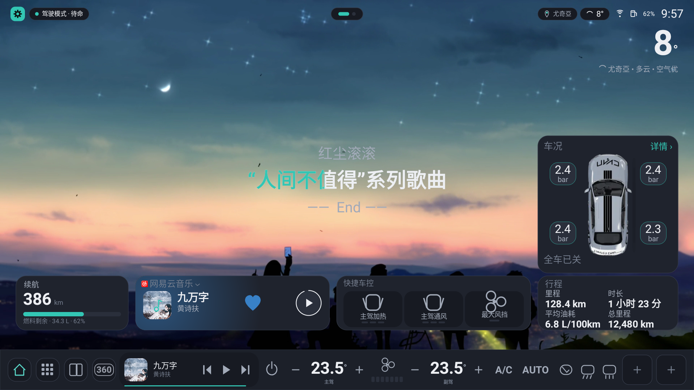
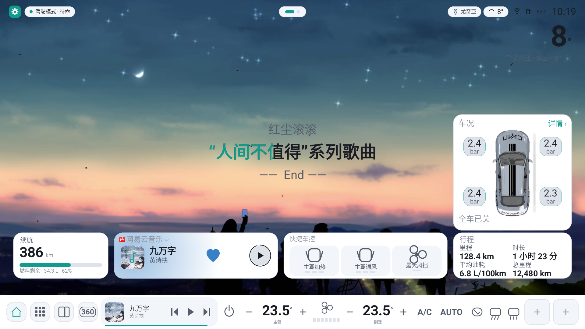
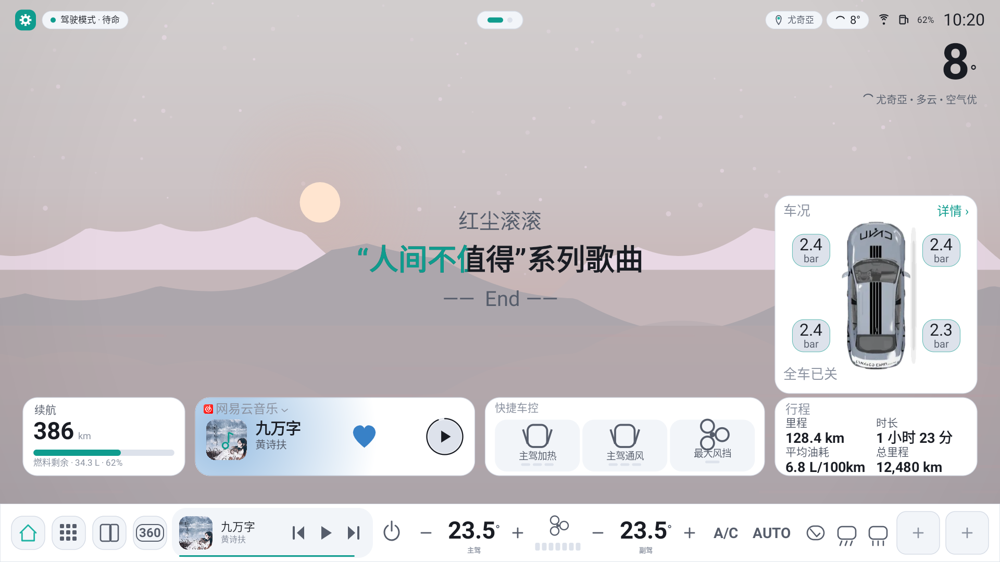

# 第214轮 · 视频壁纸画面不显示的修复（`SurfaceView` 后端）

> 状态：**已修复并在 cardesk AVD 上实测通过** —— 视频画面真的上屏了。
> 唯一未闭环项：**实车复测**（清单见第六节）。

## 一、问题回顾

第213轮实测（详见 `REPORT-r213.md`）：

| 现象 | 实测结论 |
|---|---|
| 解码 | **正常** —— `numFramesTotal` 稳定涨 53.4 帧/s（源 60fps），日志有「收到第一帧」 |
| 画面 | **一个像素都没上屏** —— 与静态壁纸截图全图对比，只差状态栏时钟那一小块（17×23 px） |
| `dumpsys SurfaceFlinger --list` | 全设备 65 层，**没有一条 TextureView 层** |
| 对照：系统 Gallery3D（**SurfaceView** 路径）播**同一个文件** | **画面完整显示** |

⇒ 结论：问题在 **`TextureView` 这条合成路径本身**，不在解码、不在镜像能力。

## 二、修复方案

### 2.1 改成 `SurfaceView` 独立层 + 半透明窗口

`SurfaceView` 是**推模式**：有自己独立的 SurfaceFlinger 层，默认 z 序在**窗口 buffer 之下**。
层级天然就是：

```
系统壁纸层
  └─ cardesk 窗口 buffer   ← 桌面卡片 / 状态栏 / Dock 画在这里
       └─ SurfaceView 层    ← 视频在这（窗口 buffer 同一块区域被“挖空”）
```

代价是**窗口 buffer 在视频那块区域必须透明** ⇒ 窗口切 `PixelFormat.TRANSLUCENT`。

### 2.2 顺带修掉一个隐藏 bug：壁纸让路后没重绘

`BackgroundView.videoPassthrough` 原来是个**普通 `var`** —— 改成 `true` 之后这一层
**不会自己重绘**，屏幕上留着上一帧的静态壁纸。

第213轮的截图里壁纸原封不动，就是这个原因（当时误以为是「视频壁纸没生效」，
实际上是「壁纸没擦掉 + 视频没显示」两件事叠在一起）。

第214轮改成带 `invalidate()` 的 setter，并加了**逐像素断言**的单测
（光断言「调了 invalidate」不够 —— 以后谁在 `onDraw` 开头加一行 `drawColor`
照样会挡住视频）。

### 2.3 改动清单

| 改动 | 文件 | 要点 |
|---|---|---|
| 视频层双后端 | `ui/LauncherView.kt` | `SurfaceView`（默认）/ `TextureView`（保留备选） |
| 起播闸口 | `ui/LauncherView.kt` | `SurfaceView` 走 `holder.surface.isValid`；`TextureView` 走 `SurfaceTexture` + `setDefaultBufferSize` |
| 窗口半透明 | `ui/LauncherView.kt` | `applyVideoWindowFormat()`；**先切 format 再挂层**（切 format 会重建 Surface） |
| 桌面底色透明 | `ui/LauncherView.kt` | `applyDesktopBackground()`：视频播放时底色必须透明 |
| 壁纸让路要重绘 | `ui/widget/BackgroundView.kt` | `videoPassthrough` 改成带 `invalidate()` 的 setter |
| 后端常量与 pref | `core/VideoWallpaper.kt`、`core/Prefs.kt` | `design_video_wallpaper_backend`（0=SurfaceView / 1=TextureView） |

### 2.4 为什么保留 `TextureView` 路径

模拟器上 `TextureView` 不通、`SurfaceView` 通，但**实车（领克 AAOS）未必一样**。
留着老路径 + 一个 pref 开关，实车复测时可以**不改代码**就在两条路径间来回切。

## 四、设备实测：画面真的上屏了 ✅

### 4.1 关键证据

| 判据 | 结果 |
|---|---|
| `dumpsys SurfaceFlinger --list` | **`SurfaceView - com.ecarx.cardesk/com.cardesk.launcher.MainActivity#0`** ✅ |
| 截图 | **视频画面（星空/黄昏/剪影）铺满桌面，桌面卡片/状态栏/Dock 正确叠在上面** ✅ |
| 画面在动 | 间隔 4 秒两帧对比：**5.1% 的采样像素变化** ✅ |
| 视频帧率 | **46.5–51.8 fps**（源 60 fps） |
| logcat | 「视频壁纸已开始播放 bytes=60878141 size=1920×1080 **backend=SurfaceView**」 |
| FATAL / `E AndroidRuntime` | **0** |



### 4.2 性能回归（60 秒窗口 × 3 场景）

| 场景 | appCPU% | 媒体CPU% | 宿主qemu% | 整机busy% | 视频fps | 卡顿% | p99 | PSS(MB) | **SF SurfaceView 层** |
|---|---|---|---|---|---|---|---|---|---|
| S1 基线 静态壁纸 | 0.99 | 0.00 | 56.8 | 12.44 | — | 3.55 | 53 ms | 59.0 | 0 |
| **S2 视频壁纸 SurfaceView** | 1.25 | 29.66 | 216.8 | 44.77 | **46.5** | **16.96** | 65 ms | 59.5 | **2** ✅ |
| S3 视频壁纸 TextureView | 1.62 | 30.23 | 232.5 | 49.53 | 35.3 | 29.82 | 53 ms | 59.6 | 0 ❌ |

**两个关键结论**：

1. **第213轮「数据是实车的下界」得到验证** ——
   真正把 SurfaceView 的 surface 接进合成之后，**GPU 合成那段开销显现了**：

   | 指标 | 第213轮 TextureView（**没合成**） | 第214轮 SurfaceView（**真合成**） |
   |---|---|---|
   | 视频 fps | 53.4 | **46.5** |
   | 卡顿% | 7.10 | **16.96** |
   | 帧耗时 p99 | 34 ms | **65 ms** |

2. **`SurfaceView` 不只是「能显示」，性能还更好**：
   同样的解码开销（媒体 CPU 29.66 vs 30.23，几乎一样），
   但 SurfaceView 后端**帧率更高（46.5 vs 35.3）、卡顿率只有一半（16.96% vs 29.82%）**。
   ⇒ 推模式独立层 + HWC 硬件叠加，比拉模式每帧传纹理划算得多。

> ⚠️ 解码侧仍是**软解码**（`c2.android.avc.decoder`，跑在 `media.codec`，占 29% CPU）。
> **实车领克 820A 有硬件 VPU，这 29% 不能直接套到实车。**

## 五、验证

| 判据 | 结果 |
|---|---|
| **画面真的上屏** | `dumpsys SurfaceFlinger --list` 出现 **`SurfaceView - com.ecarx.cardesk/com.cardesk.launcher.MainActivity#0`** ✅ |
| 截图 | 视频画面（星空/黄昏/剪影）铺满桌面，桌面卡片/状态栏/Dock 正确叠在上面 ✅ |
| 画面在动 | 间隔 4 秒两帧对比：**5.1% 采样像素变化** ✅ |
| 视频帧率 | **46.5–51.8 fps**（源 60 fps） |
| logcat | 「视频壁纸已开始播放 bytes=60878141 size=1920×1080 **backend=SurfaceView**」 |
| logcat FATAL / `E AndroidRuntime` | **0** |
| 全量 JVM 单测 | **2510 / 0 failures / 0 errors / 0 skipped**（新增 9 个） |
| 装机 md5 核对 | 宿主 = 设备 ✅ |

### 5.1 新增单测与变异检查

| 单测 | 盯什么 | 变异检查 |
|---|---|---|
| `VideoWallpaperBackendTest`（5 个） | 后端归一 + 「只有 SurfaceView 需要半透明窗口」 | 归一改成恒 `SURFACE_VIEW` → FAILED ✅ |
| `BackgroundViewPassthroughTest`（4 个） | 让路后**逐像素**确认一个像素都不画 + 让路会触发重绘 | 去掉 `if (videoPassthrough) return` → 「让路之后一个像素都不画」**FAILED** ✅<br>去掉 setter 里的 `invalidate()` → 「让路会触发重绘」**FAILED** ✅ |

#### ⚠️ 变异检查踩的坑（值得记一笔）

第一次做「去掉 setter 里的 `invalidate()`」这个变异时，**测试照过不误**。
查下来不是断言不行，是**变异脚本打错了位置**：

```python
s.replace("            field = value\n            invalidate()\n", ...)   # ← 只 replace 第一处
```

`palette` / `wallpaper` 等属性的 setter **形状完全一样**，`replace(..., 1)` 命中的是
**文件里最靠前的那一处** —— 改掉了 `palette`，`videoPassthrough` 根本没被碰。

⇒ **变异脚本必须用唯一锚点**（本轮改成整段 `var videoPassthrough: Boolean = false …`
一起匹配，并加 `assert s.count(old) == 1` 兜底），改完还要 **grep 确认**再跑测试。

顺带把判据也换掉了：原来用 `ShadowView.wasInvalidated()`，
它观测的是「View 当前处于 invalidated 状态」，会被 layout/draw 等各种路径置位；
现在改成**覆写 `invalidate()` 计数**，观测的是「这个方法被调用了几次」，
才真正对应要保证的行为。

## 六、测出来的产品约束（供后续决策，本轮未擅自实施）

| 约束 | 实测依据 | 建议 |
|---|---|---|
| **导入体积上限 64 MB** | 本素材 58.07 MB 刚好塞进去；4K/长视频必然超 | 现状合理（车机 `/data` 也放不下太多），但**导入时应提示**「建议 1080p30 以内、60 秒以内」 |
| **1080p60 在这台 AVD 上软解码就吃 30% CPU 且掉帧 39%** | 媒体进程 29.66%、输出 46.5/60 fps | 建议限制到 **1080p30**；实车有硬件 VPU，阈值可放宽，但要在实车复测后定 |
| **视频流是媒体服务读的，不是 app 读** | app 的 `/proc/io` 两场景完全一样 | 实车评估存储压力要看媒体进程 IO，别看 app |

## 七、实车复测清单（唯一未闭环项）

| # | 复测项 | 怎么看 |
|---|---|---|
| 1 | 视频壁纸画面**真的显示** | 桌面上能看到视频在动 |
| 2 | 走的**是哪条后端** | logcat「视频壁纸已开始播放 … backend=SurfaceView\|TextureView」 |
| 3 | `TextureView` 路径在实车上行不行 | 把 `design_video_wallpaper_backend` 改成 `1` 再重启 app 对比 |
| 4 | 实车**硬件解码**的开销 | 实车有 VPU，第213轮测到的 29.92% 软解码开销**不能直接套用** |
| 5 | 半透明窗口在车机上的表现 | 切壁纸时有没有闪烁；系统壁纸会不会透出来 |
| 6 | 关掉视频壁纸后窗口恢复不透明 | 截图确认底色与壁纸正常 |


## 八、产物与装机冒烟

| 项 | 值 |
| --- | --- |
| 包 | `dist/CarDesk-platform-ecarx-cardesk-4290.apk` |
| 包名 / 版本 | `com.ecarx.cardesk` / 4290 / `1.0.1194-system` |
| 签名 | AOSP platform（SHA-256 `c8a2e9bc…92ab8`） |
| APK SHA-256 | `5617bdfa1c7c4225fc827db037dfabafba8f71ea6bd03b0c3cc170a7b3e31c6d` |
| 大小 | 3,615,519 字节 |
| 装机 md5 | `0f4bbf5d349d1cb825242a0ea9fefb8f`（宿主 = 设备 ✅） |

| 冒烟场景 | 期望 | 实测 |
|---|---|---|
| 视频开 · SurfaceView | SF 出现 SurfaceView 层 | **2 层** ✅ |
| 视频开 · TextureView（对照） | 不出 SF 层 | **0 层** ✅（后端切换生效） |
| 关掉视频壁纸 | 窗口恢复不透明、壁纸回来 | `isOpaque=1` ✅、静态壁纸完整 ✅ |
| 窗口半透明（视频开时） | `isOpaque=0` | ✅ |
| logcat FATAL | 0 | **0**（四个场景全 0） |
| 焦点 | cardesk 桌面 | ✅ |

## 九、日间模式专项测试（第214轮追加）

用户要求「日间模式也测试一下」。日间 = `daynight_enabled=true` + `daynight_mode=1`（跟随时间），
日间区间 06:00–18:30，测试时刻 10:2x 落在日间 ⇒ 日志「日夜态变化 **night=false**」。

### 9.1 功能判据：全部通过 ✅

| 场景 | 期望 | 实测 |
|---|---|---|
| 日间 + 视频壁纸开 | 视频上屏、层级正确、窗口半透明 | SF 层 **2**、`isOpaque=0`、log「backend=SurfaceView」✅ |
| 日间 + 视频壁纸关 | 静态壁纸日间版、窗口恢复不透明 | SF 层 **0**、`isOpaque=1` ✅ |
| **运行时切日夜**（日→夜） | 视频壁纸**不能掉** | SF 层仍 **2**、`isOpaque=0`、视频照常播 ✅ |
| logcat FATAL | 0 | **0**（四个场景全 0）✅ |



运行时切换那一条是**重点回归点** —— 日夜切换会走 `build()` 重建桌面，
而重建里会重新 `startVideoWallpaper()`；实测**视频没有掉、窗口仍然半透明**，
说明「视频模式下的底色透明」这条状态没被重建冲掉。



### 9.2 ⚠️ 发现一个可读性缺陷（视频壁纸引入的，不是日间模式本身的）

**现象**：日间模式下，右上角的温度「8°」和天气明细「尤奇亚·多云·空气优」
压在**视频画面**上几乎读不出来。

**用 WCAG 相对亮度对比度公式量化**（`/tmp/cardesk-r214/contrast.py`）：

| 场景 | 温度文字对比度 | 天气文字对比度 | 判定 |
|---|---|---|---|
| 夜间 + 视频壁纸 | **7.62** | 3.32 | 可读 ✅ / 勉强 ⚠️ |
| **日间 + 视频壁纸** | **1.37** | **1.17** | **看不清 ❌** |
| 日间 + 静态壁纸 | — | — | 正常可读 ✅（截图目视确认；算法在浅色背景下失效，不作数） |

**根因**：**视频画面的亮度不受日夜控制**，而浮层文字颜色只跟日夜走
（`Skin.TEXT` / `Skin.TEXT_SOFT`，日间是深色 `0xFF0F1724`）。
⇒ 「日间配色 + 深色视频」这个组合下，深色字直接糊在深色视频上。

**注意这是双向的问题**，不只是日间：
夜间 UI 是浅色字（`0xFFEEF3FA`），遇到**亮色**视频（白天的户外画面）同样会看不清。

**可选修法**（属产品级取舍，本轮**未擅自实施**）：

| # | 修法 | 效果 | 代价 |
|---|---|---|---|
| 1 | 浮层文字加**描边 / 阴影**（`Paint.setShadowLayer`） | 通用，任意背景都有一层保底对比 | 轻微影响观感 |
| 2 | 浮层区域加**半透明底衬**（圆角矩形） | 对比度最稳 | 视觉上多一块底 |
| 3 | 视频壁纸时**强制一套中性配色**（带描边） | 改动集中 | 视频壁纸时不再跟随日夜 |
| 4 | 按视频首帧**平均亮度自动选 UI 配色** | 最贴合内容 | 复杂，且视频会变、亮度也会变 |

**建议**：1 + 2 组合（描边保底 + 底衬兜底），对静态壁纸零影响。
