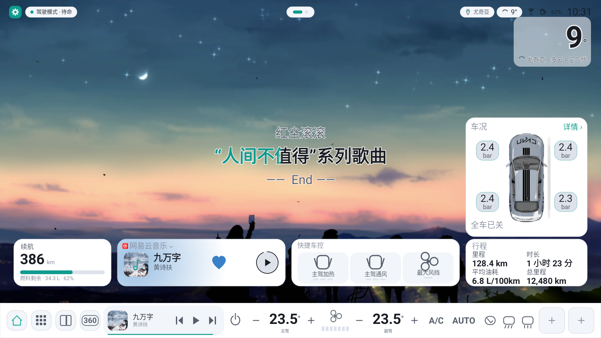

# 第215轮 · 视频壁纸下的浮层文字可读性（描边 + 底衬）

> ⛔ **已回退（第217轮）** —— 用户反馈「改得有点丑」，
> 本轮的**描边 + 底衬**方案已**全部撤销**（代码 + 单测）。
> ⇒ 视频壁纸下**不再做任何浮层增强**，浮层文字直接压在视频画面上。
> 保留本章作为**决策记录**：这条路的做法、实测数据、踩过的坑都在这里，
> 以后要重做（比如换成更克制的半透明遮罩而不是描边）可以直接复用。
> 回退明细见第217轮章节 / `emu-verify/REPORT-r217.md`。

> ⚠️ **勘误（见第216轮）**：本轮给「顶栏」加描边时改的是 `ui/widget/StatusBarView`
> （**左侧**「驾驶模式」那块），而屏幕最上方真正在用的顶栏是 `ui/shell/ShellStatusBar` ——
> 右上角的时间 / 油量% / 连接图标仍是裸元素，日间 + 视频壁纸时对比度只有 **1.95**。
> ⇒ 第216轮补上了这一处。

> 状态：**已实现并在 cardesk AVD 上实测通过**（日夜两种模式对比度均达标）。

## 一、问题

第214轮日间模式实测时测出来的缺陷：视频壁纸开启时，桌面浮层**直接压在视频画面**上，
而**视频画面的亮度不受日夜控制**，浮层文字颜色却只跟日夜走。

第214轮的实测数据（WCAG 相对亮度对比度，≥4.5 = 正文 AA）：

| 场景 | 温度文字 | 天气文字 | 判定 |
|---|---|---|---|
| 夜间 + 视频壁纸 | 9.88 | 3.49 | 可读 / 勉强 ⚠️ |
| **日间 + 视频壁纸** | **2.15** | **1.25** | **看不清 ❌** |
| 日间 + 静态壁纸 | — | — | 可读 ✅ |

⇒ 这不只是日间的问题：**夜间 UI 是浅色字，遇到亮色视频同样会看不清**。

## 二、修法：描边 + 底衬

### 2.1 ⚠️ 两个必须绕开的 API 事实

| 事实 | 后果 |
|---|---|
| **`android.graphics.Paint` 没有 `strokeColor`** | 描边和填充**共用 `color`** ⇒ `Style.FILL_AND_STROKE` 画出来是**同色加粗**，对比度一点没提升 |
| **`Paint.setShadowLayer` 在硬件加速的 Canvas 上不生效** | Android 只在软件层支持 shadow layer，桌面是硬件加速的 ⇒ 用它等于什么都没做（不报错、也不画） |

⇒ 唯一可行：**两遍画** —— 先画一遍**对比色的空心加粗**（描边层），
再画一遍**原色的实心正文**（正文压在描边上）。
（`LyricWipeText` 的 `haloColor`/`haloWidth` 本来就是这个机制，直接复用。）

### 2.2 改动清单

| 改动 | 文件 | 要点 |
|---|---|---|
| **token + helper** | `core/Skin.kt` | `overlayOnVideo` / `overlayStroke` / `overlayScrim`；`drawOverlayStroke()` 两遍描边；`overlayStrokeWidth()` |
| **天气块底衬** | `ui/pages/ScenePage.kt` | 右上角温度/天气/图标整块铺半透明圆角矩形 |
| 天气文字描边 | `ui/pages/ScenePage.kt` | 温度 96px / 度数 38px / 明细 20px 逐个两遍画 |
| 中心歌词描边 | `ui/pages/ScenePage.kt` | 当前句走 `LyricWipeText` 的 `halo` 通道；衬句两遍画 |
| 顶栏文字描边 | `ui/widget/StatusBarView.kt` | 时间/日期/续航/车外温度 |
| 顶栏图标描边 | `ui/widget/StatusBarView.kt` | 齿轮/电池/wifi/蓝牙：先整体画加粗对比色一遍，再画原色 |
| **开关** | `ui/LauncherView.kt` | 起播成功 → `Skin.overlayOnVideo = true`；停止/出错 → `false` |

**描边与底衬的颜色跟日夜互补**（在 `Skin.apply` 里按 `pal.night` 更新）：

| | 文字 | 描边 / 底衬 | 理由 |
|---|---|---|---|
| 夜间 | 浅色 `0xFFEEF3FA` | **深色** `0xB3000000` / `0x73000000` | 浅字压深色才顶得出来 |
| 日间 | 深色 `0xFF0F1724` | **浅色** `0xE6FFFFFF` / `0x8CFFFFFF` | 深字压浅色才顶得出来 |

**对静态壁纸零影响**：`overlayOnVideo` 只在视频壁纸播放时为 `true`，静态壁纸下一直是 `false`，
描边与底衬都不画。换肤（日夜切换）**不会**重置它 —— 它是运行状态，不是主题 token。

## 三、实测效果（对比度）

指标：区域动态范围（区域内最亮 5% 与最暗 5% 的中位数之间的对比度）。

| 区域 | 日间 修复前 | 日间 修复后 | 夜间 修复前 | 夜间 修复后 |
|---|---|---|---|---|
| 温度大字 | **2.15 ❌** | **15.90 ✅** | 9.88 ✅ | **17.06 ✅** |
| 天气明细 | **1.25 ❌** | **6.60 ✅** | 3.49 ⚠️ | **7.46 ✅** |
| 中心歌词 | 9.29 ✅ | 15.76 ✅ | — | 11.42 ✅ |
| 顶栏右侧 | 13.35 ✅ | 13.29 ✅ | — | — |

⇒ 原来「看不清」的两处（2.15 / 1.25）现在都 **≥ 6.6**，超过 WCAG AA 的 4.5；
夜间「勉强」的天气明细（3.49）也升到 **7.46**。

## 四、验证

| 判据 | 结果 |
|---|---|
| 全量 JVM 单测 | **2517 / 0 failures / 0 errors / 0 skipped**（新增 7 个） |
| 新增单测 · 变异检查 | 去掉「没开增强就不画」的闸口 → 「开增强时描边层会多画一圈」**FAILED** ✅ 换肤时不更新描边色 → 3 个**FAILED** ✅ |
| 设备实测 · 日间 | 画面上屏、FATAL **0**、对比度达标 ✅ |
| 设备实测 · 夜间 | 画面上屏、FATAL **0**、对比度达标 ✅ |
| 静态壁纸不受影响 | `overlayOnVideo` 恒 `false` ⇒ 不画描边/底衬 ✅ |

### 4.1 踩到的两个坑

1. **`Paint` 没有 `strokeColor`** —— 第一版实现用了 `Style.FILL_AND_STROKE` + `strokeColor`，
   编译直接报错才暴露出来。顺带确认了「同色加粗」在原理上也不可能有对比度收益。
2. **Robolectric 默认图形模式不渲染文字** —— `canvas.drawText` 在 LEGACY 模式下画不出任何像素，
   断言全成空跑。必须加 `@GraphicsMode(GraphicsMode.Mode.NATIVE)`。
